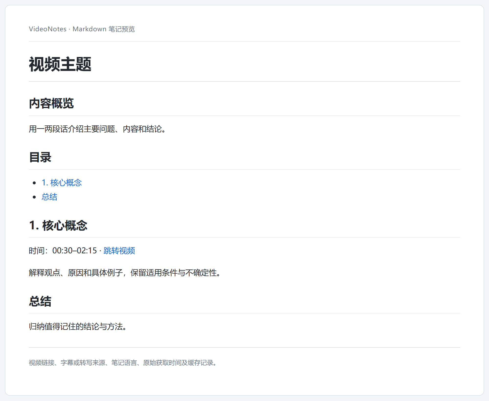

# VideoNotes

把视频链接整理为带时间定位的详细 Markdown 笔记，方便阅读、复习和回到视频核对。

优先获取现成字幕；没有可用字幕时，下载音频并在本机转写。当前 AI 助手负责理解、翻译和写笔记。笔记生成无需另配模型 API Key，音频转写可选择本地 Whisper 或 MOSS 模型。

**笔记效果示意**（内容与时间为演示占位）：



## 功能与限制

**当前自动安装和浏览器通信支持 Windows + Chrome，需要 Python 3.10 或以上。** 使用的 AI 助手须能够读取本机文件、执行命令并保存 Markdown；仅聊天或无法访问本机的环境不能完成本地安装。

视频可访问性受登录、网络和站点限制影响，不保证所有视频都能提取。平台字幕与语音识别都可能出错；末尾时间检查不能证明语义准确或中途没有遗漏。

抖音支持 `www.douyin.com/video/<视频 ID>` 和带 `modal_id=<视频 ID>` 的网页链接。命令行或技能调用还支持 `v.douyin.com/<短码>/` 视频分享短链，也可接收包含一条该短链的分享文案；扩展面板只接受已适配的视频详情页。短链会先解析为单视频链接，再检查独立字幕轨；没有字幕轨时，从抖音视频数据取得原声媒体地址并沿用已选的本地模型转写。图文作品不属于可转写视频，会给出明确提示。普通视频可能没有独立音轨，此时需下载含画面的 MP4。抖音数据接口可能变化，访问失败时会明确返回错误。扩展已增加抖音网站权限；更新扩展后请在 `chrome://extensions` 中重新加载并允许该权限。

当前不分析视频画面、不执行 OCR，也不自动插入截图。依赖画面的讲解会在笔记中注明局限。Python 和扩展面板只提取原文，最终笔记由调用它们的助手生成。

## 快速开始

**安装 → 完成首次配置 → 提供视频链接 → 得到笔记。**

1. 把仓库链接发给支持本地操作的 AI 助手：

   > 安装skill https://github.com/HamsterST/video-notes.git

2. 等待助手完成轻量初始化；然后在 Chrome 中加载助手给出的 `extension` 目录。
3. 完成下方的安装验证，再发送：

   > 用 video-notes 把这个视频整理成详细中文笔记：〈视频链接〉

4. 助手获取完整原文并生成 `.md` 文件，默认保存到当前任务工作区的 `outputs`，交付文件链接。

## 首次安装

### 安装 Skill

仓库根目录就是完整 Skill。使用当前助手支持的技能安装器，或下载、克隆完整项目后接入宿主的技能发现目录。安装目录建议命名为 `video-notes`。

必须保留 `SKILL.md`、`scripts/`、`video_notes/`、`extension/`、`rules/` 和 `pyproject.toml`，不能只复制 `SKILL.md`。

如需放到其他磁盘，在安装请求中指定目录。已有安装的 `runtime.json`、模型选择和数据应保留。复制完成只表示 **Skill 文件已安装**，仍需初始化运行环境。

### 初始化 Python 环境

用户需自行安装 Python 3.10+，本项目不下载或安装 Python。助手检查已有环境：依赖满足要求时直接复用，不修改原有环境；不满足时才创建独立 `.venv` 并安装所需依赖。首次只需字幕获取与扩展通信依赖，不询问模型。只有首次需要语音转写时，才询问一次模型，并按所选后端安装依赖、按需下载模型：

| 模型 | 模型文件占用空间（约） | 选择参考 |
| --- | --- | --- |
| `small` | 486 MB | 默认推荐，较轻量 |
| `large-v3-turbo` | 1.62 GB | 速度与识别质量折中 |
| `large-v3` | 3.09 GB | 质量优先，CPU 上处理长音频可能较慢 |
| `moss-0.9b` | 1.83 GB | 长音频转写并区分匿名说话人，直接输出时间戳；运行依赖与内存占用更高 |

以上为模型仓库文件的磁盘体积，采用十进制 MB/GB，不是运行时内存或显存需求；不包含 Python 环境、依赖、音视频和额外下载缓存。模型版本或缓存方式变化时实际占用可能不同，下载时需额外预留空间。模型按需下载，切换后已下载的模型会保留，占用会累加。

模型文件大小参考：[small](https://huggingface.co/Systran/faster-whisper-small/tree/main)、[large-v3-turbo](https://huggingface.co/dropbox-dash/faster-whisper-large-v3-turbo/tree/main)、[large-v3](https://huggingface.co/Systran/faster-whisper-large-v3/tree/main)、[MOSS 0.9B](https://huggingface.co/OpenMOSS-Team/MOSS-Transcribe-Diarize/tree/main)。MOSS 官方说明支持最长 90 分钟音频，输出 `[S01]` 等匿名标签；这些标签不能当作真实身份。MOSS Python 路线官方在 Python 3.12 和 Transformers 5.x 上验证，CPU 长音频性能需按本机条件评估。模型代码与安装包固定到特定修订，首次使用会按需下载；不会自动切换现有 Whisper 选择。

模型选择时会同时展示：“模型和缓存将保存到〈实际数据目录〉；如需换盘，可在选择模型时同时指定目录。”不增加单独的目录问题；指定新位置后先切换数据目录，再下载模型。

已有选择或用户已明确指定模型时不再询问。命令行与扩展后台转写默认使用 NVIDIA GPU（`cuda`）；命令行可用 `--device cpu` 显式选择 CPU，不静默退回 CPU。Whisper 需要 CUDA 12 的 cuBLAS 和 cuDNN 9；Windows 下会自动加载当前 Python 环境中 CUDA 版 PyTorch 的运行库，也可使用 PATH 中已有的系统运行库。MOSS 需要 CUDA 版 PyTorch；不支持 BF16 的显卡使用 FP16。轻量安装仍不自动安装 CUDA，首次 GPU 转写前应确认对应环境可用。

助手执行以下初始化入口；普通用户无需手动运行：

```text
<可用的 Python> <安装目录>/scripts/bootstrap.py
```

脚本优先复用依赖满足要求的 Python；否则在项目 `.venv` 中安装依赖，然后注册本机通信并生成 `runtime.json`。有字幕的视频无需安装语音识别依赖。

首次确实需要转写时，助手根据 `model_selection_required` / `dependency_missing` 状态执行：

```text
<runtime.python> <安装目录>/scripts/bootstrap.py --transcribe --model <选择的模型>
```

已有模型选择时不再询问，`--transcribe` 可以省略 `--model`。安装依赖不下载模型权重，随后重试视频请求时才下载所选模型。首次转写仍需等待安装和下载。

脚本成功表示 **运行环境就绪**。网络或权限限制仍可能阻止安装，应按实际错误处理。`setup.cmd` 是另一个手动安装入口，通过助手完成初始化的用户无需重复运行。

### 加载 Chrome 扩展

此步骤需要用户在 Chrome 中完成一次：

1. 打开 `chrome://extensions`。
2. 开启“开发者模式”。
3. 点击“加载已解压的扩展程序”，选择助手提供的完整 `video-notes/extension` 目录。

需要登录的视频，请在安装扩展的 Chrome 配置中登录对应平台，并保持 Chrome 运行。日常通过助手使用时，无需每次打开视频标签页或点击扩展。

扩展面板也可以单独提取原文，但面板显示“已获取字幕”不代表已经生成笔记。

## 验证安装

请分别确认以下三个阶段，不以“文件已复制”代替全部验证：

| 阶段 | 检查内容 | 通过标志 |
| --- | --- | --- |
| Skill 已安装 | 宿主能发现 Skill；项目所需文件完整 | 助手能读取 `SKILL.md` 并定位项目 |
| 运行环境就绪 | `runtime.json` 中的路径有效；Python 依赖可导入 | 初始化返回 `runtime_ready`，依赖检查通过 |
| 浏览器连接已验证 | Chrome 运行、扩展启用；实际请求扩展连接 | 请求成功，不输出 Cookie 内容 |

最后用一个可访问且有字幕的视频做提取验证：

> 用 video-notes 验证这个链接的字幕提取，禁止下载和转写，暂不生成笔记：〈视频链接〉

成功素材应为 `status=ok` 且包含有效 `segments`。`notes_generated=false` 是正常的，表示 Python 没有写笔记。

**命中缓存只能验证素材复用，不能验证当前扩展连接。** 需要测试实时提取时明确要求刷新；对应 CLI 使用 `--refresh --fallback stop`。扩展面板与 CLI 使用不同的通信入口，面板成功时也应单独验证 CLI。

## 日常使用

### 提供视频链接

> 用 video-notes 整理这个视频，生成带时间定位的详细中文笔记：〈视频链接〉

也可以指定笔记语言，或明确要求“只使用字幕，不下载、不转写”。B 站多分集链接请保留 `p` 参数。

### 使用本地字幕或已有结果

> 用这份字幕生成视频笔记：〈字幕文件路径〉。对应视频链接是：〈视频链接〉。

支持已有 SRT、VTT、字幕 JSON 和成功的 VideoNotes 结果 JSON。已有原文会直接用于整理，不重复下载或识别。也可提供本地音视频作为转写后备；`--local-video` 仍会先尝试链接字幕。

### 切换模型

> 把 video-notes 的默认转写模型改为 large-v3-turbo。

或者：

> 这个视频仅本次使用 large-v3 转写。

`--set-model` 保存默认值，`--model` 仅覆盖本次。CLI 也接受其他兼容模型名称或本地模型路径。更大模型不保证所有内容都识别得更好，处理速度取决于设备。

## 数据保存位置

使用过程中可能产生以下文件，按需创建。模型和缓存使用实际配置的数据目录；最终笔记保存在当前任务工作区或用户指定的位置。

```text
数据目录/
├── settings.json             # 默认转写模型选择
├── models/                   # 下载的本地 Whisper 或 MOSS 模型
├── downloads/                # 下载的音频或媒体、下载碎片及清单
├── cache/                    # 完整字幕、转写结果及查询索引
├── results/                  # 扩展面板保存的原文 TXT / JSON
└── media-policy.json         # 媒体缓存保留设置

任务工作区/
└── outputs/
    └── <视频标识>.notes.<语言>.md  # 生成的视频笔记

Skill 所在目录/
├── .venv/                    # 独立 Python 环境（已有环境依赖不满足时才创建）
├── runtime.json              # 本机运行环境配置
├── storage.json              # 自定义数据目录配置（指定后生成）
└── data/
    └── native/               # 浏览器通信配置、启动脚本及本机口令
```

## 许可证

本项目采用 [MIT 许可证](LICENSE)，Copyright (c) 2026 HamsterST。第三方依赖和模型遵循各自的许可证。
